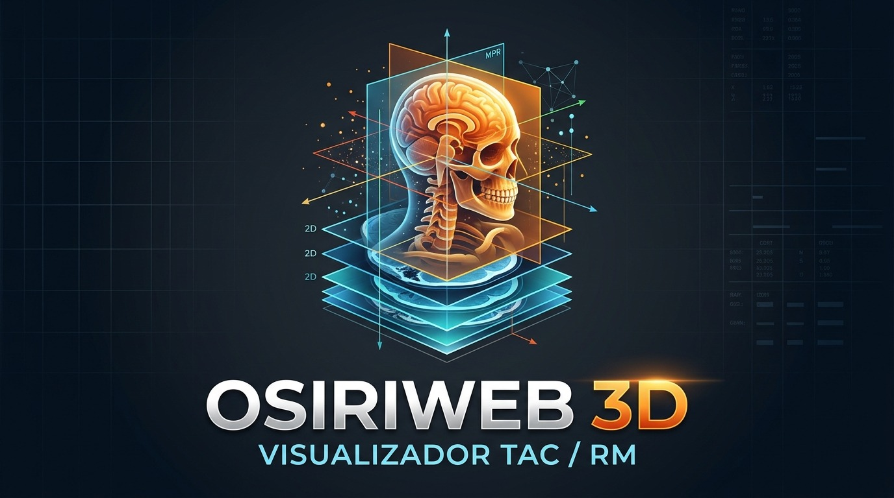

<p align="center">
  
</p>

# OsiriWeb 3D — Visualizador TAC / RM

Aplicação web progressiva (**PWA**) inspirada no **OsiriX HD**, concebida para visualização de exames de **TAC** e **RM** com reconstrução volumétrica **3D em tempo real (WebGL2)** e visualização **MPR sincronizada**, otimizada para **iPad**, **iPhone** e **Desktop**.

Todo o processamento decorre **100% localmente no navegador** — nenhum ficheiro clínico ou imagem é enviado para servidores externos.

---

## Funcionalidades Principais

* **Motor 3D Volumétrico em Tempo Real (WebGL2 Raymarching):**
  * Modos **VR** (Volume Rendering com iluminação Phong), **MIP**, **MinIP** e **Iso-Superfície**.
  * Presets clínicos: *Osso*, *Angio*, *Tecidos Moles*, *Pulmão* e *PET*.
  * Planos de corte 3D (*Clipping X/Y/Z*), ajuste de espessura Z, opacidade/limiar e otimização automática de fluidez em ecrãs táteis.
* **Layouts estilo OsiriX HD & MPR Sincronizado:**
  * Modos *2D Único*, *MPR + 3D* (Axial, Coronal, Sagital + 3D) e *3D Ecrã Inteiro*.
  * Miras MPR interativas arrastáveis com orientação anatómica (`A/P`, `R/L`, `S/I`).
* **Importador Multifonte (`+ Importar / Criar TAC`):**
  * **DICOM (`.dcm` / pasta):** Leitura múltipla ou de pasta completa com ordenação automática de cortes e extração de metadados HU.
  * **Vídeo → TAC/RM:** Extração de cortes a partir de `.mp4`/`.mov`/`.webm` com recorte visual **ROI** para remover barras/texto PACS.
  * **Sequência de Imagens:** Empilhamento ordenado naturalmente de `.png`/`.jpg`/`.webp` num volume 3D.
  * **PDF → TAC/RM:** Pré-visualização com **Grelha por Página (Contact Sheet)** (`1×1`, `2×2`, `3×3`, `4×4`, personalizado) para converter folhas de contacto radiológicas em volumes 3D.
* **Ferramentas Clínicas:**
  * Navegação de cortes + modo **Cine**, **Window/Level** interativo e presets (*Cérebro*, *Osso*, *Pulmão*, *Tecidos Moles*, *Angio*), **Zoom/Pan** (incluindo pinça), **Régua (mm)**, **ROI Circular** (Área mm², Média ± DP HU), **CLUTs 2D** e exportação **PNG**.
* **2 Exames 3D de Demonstração Integrados:** *TAC Crânio + Angio* e *TAC Tórax / Coluna*.

---

## Estrutura do Repositório

```text
.
├── index.html                   # Aplicação completa (HTML/CSS/WebGL2/JS)
├── manifest.json                # Configuração PWA (iPad / iPhone / Desktop)
├── sw.js                        # Service Worker para cache offline
├── .nojekyll                    # Evita processamento Jekyll no GitHub Pages
├── .github/workflows/pages.yml  # Deploy automático via GitHub Actions
├── assets/
│   ├── logo-banner.jpg          # Logótipo banner (Splash Screen & Sobre)
│   ├── apple-touch-icon.png     # Ícone 180×180 para iPad / iPhone
│   ├── icon-192.png             # Ícone PWA 192×192
│   ├── icon-512.png             # Ícone PWA 512×512
│   └── favicon.png              # Favicon 64×64
├── LICENSE                      # Licença MIT
└── README.md
```

---

## Publicar no GitHub Pages

### Opção A — Pela interface Web do GitHub (sem terminal)
1. Cria um novo repositório público no GitHub (ex.: `osiriweb-3d`).
2. Descompacta o ficheiro `osiriweb-3d-github.zip` no computador.
3. No repositório criado, clica em **Add file → Upload files** e arrasta **todos os ficheiros e pastas** (`index.html`, `manifest.json`, `sw.js`, `.nojekyll`, `assets/`, `.github/`, etc.) e faz **Commit changes**.
4. Vai a **Settings → Pages**. Em **Build and deployment → Source**, escolhe **GitHub Actions** (ou **Deploy from a branch → `main` / `/ (root)`**).
5. Em cerca de 1 minuto a aplicação fica ativa em `https://<teu-utilizador>.github.io/osiriweb-3d/`.

### Opção B — Via linha de comandos (`git`)
```bash
cd osiriweb-3d
git init -b main
git add .
git commit -m "Versão inicial OsiriWeb 3D"
git remote add origin https://github.com/<teu-utilizador>/osiriweb-3d.git
git push -u origin main
```
Depois ativa **Settings → Pages → Source: GitHub Actions** no repositório.

---

## Instalar no iPad e iPhone (Ecrã Inteiro)
1. Abre o endereço `https://<teu-utilizador>.github.io/osiriweb-3d/` no **Safari**.
2. Toca no botão **Partilhar** (quadrado com seta para cima).
3. Seleciona **Adicionar ao ecrã principal** e confirma.
4. O ícone do **OsiriWeb 3D** aparece no ecrã inicial e abre em modo ecrã inteiro sem barras do navegador.

---

## Aviso Clínico
O **OsiriWeb 3D** destina-se a fins educacionais, demonstração técnica e visualização auxiliar. **Não é um dispositivo médico certificado (CE / FDA)** e não deve ser utilizado para diagnóstico clínico primário.
